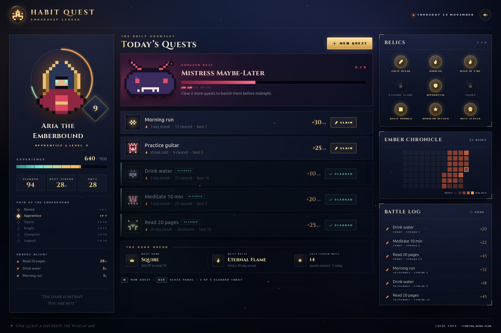
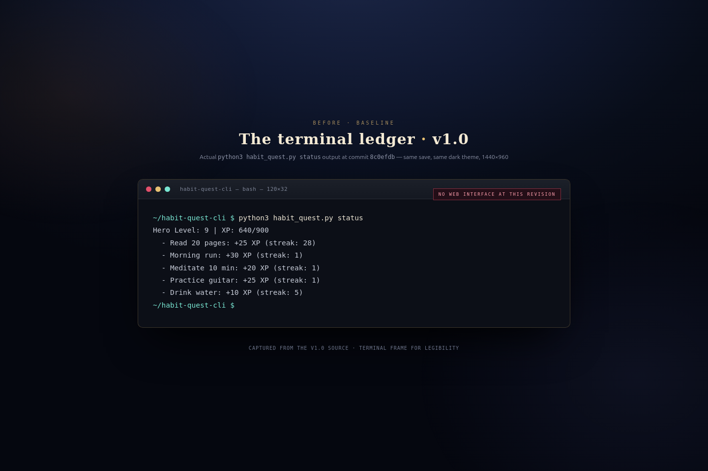
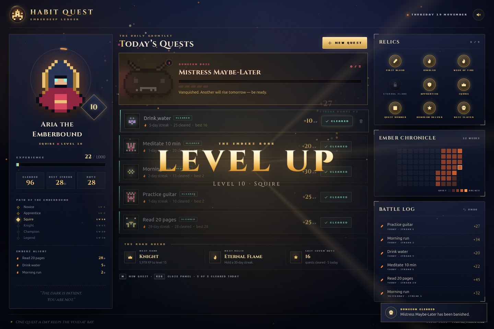
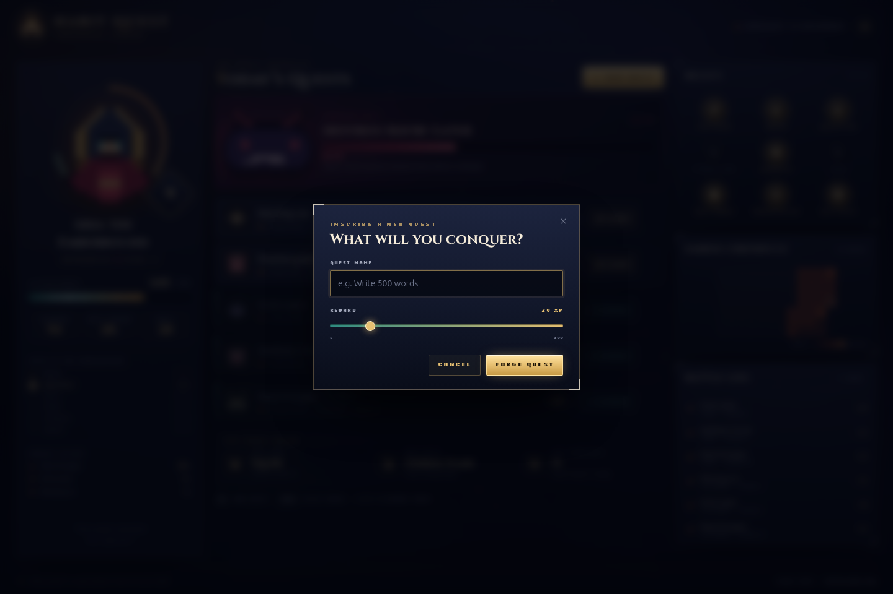
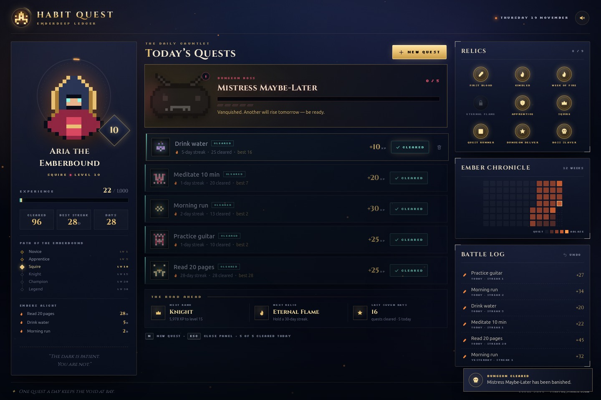
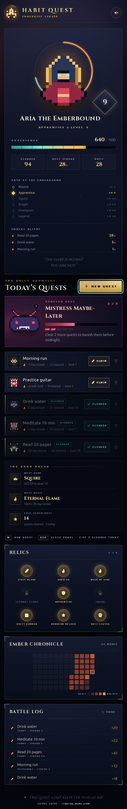

# Habit Quest · Emberdeep Ledger 🗡️

A tiny terminal RPG habit tracker — now with a torch-lit web dashboard.

Every real-life habit is a quest. Clearing one earns XP, feeds a streak, unlocks
relics and chips away at the day's procrastination boss. Your hero, save file and
streaks are shared between the CLI and the browser.



## Before / after

| Before — v1.0 terminal interface | After — Emberdeep Ledger web dashboard |
| --- | --- |
|  |  |

Both captures use the same five-quest save (level 9, 640/900 XP) at 1440×960 in
the dark theme. The “before” frame is the actual `status` output of commit
`8c0efdb` (the full text is in
[`docs/screenshots/before-cli-output.txt`](docs/screenshots/before-cli-output.txt));
that revision had no web interface.

## Quick start

No third-party dependencies — Python 3.10+ and a browser are enough.

```bash
# 1. Try a ready-made four-week adventure in a throwaway save
python3 habit_quest.py --state /tmp/habit-quest-demo.json demo --yes
python3 habit_quest.py --state /tmp/habit-quest-demo.json serve
# open http://127.0.0.1:8000
```

Or start a real adventure with the default save (`~/.habit_quest.json`):

```bash
python3 habit_quest.py add "Read 20 pages" --xp 25
python3 habit_quest.py done "Read 20 pages"
python3 habit_quest.py status
python3 habit_quest.py serve --open
```

The `--state PATH` flag (or the `HABIT_QUEST_STATE` environment variable) points
at a different save. The CLI and the dashboard can safely use the same file:
the browser reads and writes the same JSON, so claim a quest in one place and
refresh the other.

## Features

### Game layer

- **XP & levels** — every quest has an XP reward; level costs grow as you climb.
- **Ranks** — Novice → Apprentice → Squire → Knight → Champion → Legend.
- **Streaks** — clear a habit on consecutive days to grow its streak and earn a
  bonus of +2 XP per streak day (capped at ten days). Miss a day and the ember
  cools; the next clear starts at one again.
- **Relics (achievements)** — nine unlockables for first clears, 3/7/30-day
  streaks, level milestones, 10/50 quests and full-dungeon clears.
- **Daily boss** — the number of open quests is the boss's HP. Clear them all to
  banish today's boss; a new one rises tomorrow.
- **Milestones** — the dashboard projects your next rank, the next relic to chase
  and your last-seven-days tally.
- **Undo** — rewind the latest completion (XP, level and streak included); remove
  or rename quests at any time.
- **Demo ritual** — `demo` seeds four weeks of believable history (with `--yes`
  required if the save already has progress).

### Web dashboard — “Emberdeep Ledger”

A single-page, offline-friendly dungeon ledger served by Python's standard
library:

- animated ember/dust field and parallax pointer response;
- hand-drawn pixel-art hero and boss sprites rendered on canvas;
- a unique procedural rune sigil generated from each quest's name;
- hero level ring, XP gauge, rank ladder and streak shrine;
- quest cards with claim, remove and per-day state;
- relic medallions, a 12-week ember heatmap and a battle log;
- add-quest and rename-hero panels, plus an empty-dungeon onboarding state;
- click the boss for a taunt; level-ups, relic unlocks and boss defeats get
  canvas bursts, a full-screen level-up flourish and synthesized Web Audio
  feedback (sound is opt-in);
- responsive layout down to phone widths and reduced-motion support.



### CLI commands

| Command | What it does |
| --- | --- |
| `add NAME [--xp N]` | Forge a new quest (1–500 XP). |
| `done NAME` | Clear it for today; prints XP, streak bonus and new relics. |
| `status` | Hero sheet, today's quests and unlocked relics. |
| `log [--limit N]` | Recent victories. |
| `achievements` | Every relic and its progress. |
| `undo` | Revert the latest completion. |
| `remove NAME` / `rename NAME` | Edit the ledger / your hero. |
| `reset --yes` | Erase all progress. |
| `export PATH` / `import PATH` | Back up or restore a save. |
| `demo [--yes]` | Seed a four-week demo adventure. |
| `serve [--host] [--port] [--open]` | Launch the web dungeon. |

## Screenshots

| Add quest | Victory |
| --- | --- |
|  |  |



## How it works

- `habit_quest.py` — game rules, persistent state, CLI and dashboard payload.
- `quest_web.py` — a small `ThreadingHTTPServer` JSON API plus static files.
- `web/` — the dashboard (`index.html`, `style.css`, `app.js`) and locally
  bundled OFL fonts; everything is self-contained and works offline.
- `tests/` — 26 unit and HTTP API tests.

State lives in one JSON file. On every clear the game records the event date,
awarded XP, streak and a small rollback snapshot; the heatmap, log and undo all
read from that log. Old v1 saves (`xp`, `level`, `habits`) are migrated on load.

API used by the dashboard (all JSON):

| Method & path | Body | Purpose |
| --- | --- | --- |
| `GET /api/state` | — | Full dashboard payload. |
| `POST /api/complete` | `{"habit": "…"}` | Clear a quest. |
| `POST /api/add` | `{"name": "…", "xp": 20}` | Add a quest. |
| `POST /api/remove` | `{"habit": "…"}` | Remove a quest. |
| `POST /api/undo` | `{}` | Rewind the last clear. |
| `POST /api/rename` | `{"name": "…"}` | Rename the hero. |
| `POST /api/demo` | `{}` | Seed a demo (only when empty). |

## Tests

```bash
python3 -m unittest discover -s tests -v
```

## Notes

The dashboard is a local tool: by default it binds to `127.0.0.1` and has no
authentication. Do not expose it to an untrusted network. Sound effects are
generated in the browser and start muted; toggle them with the speaker button.
